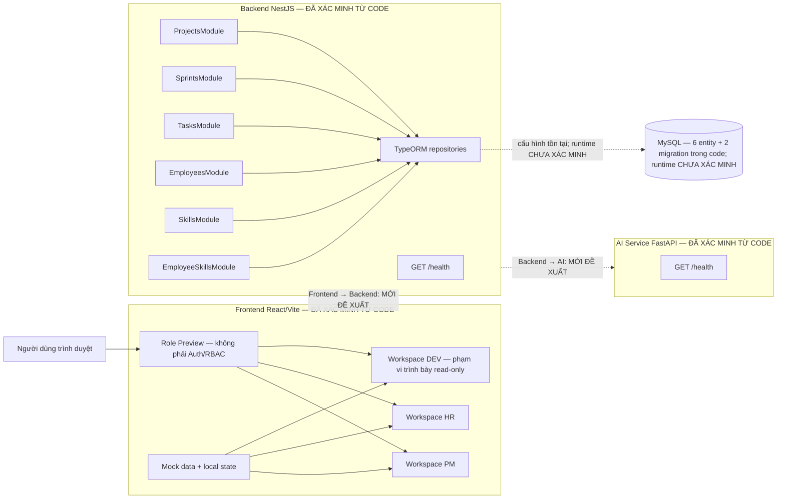
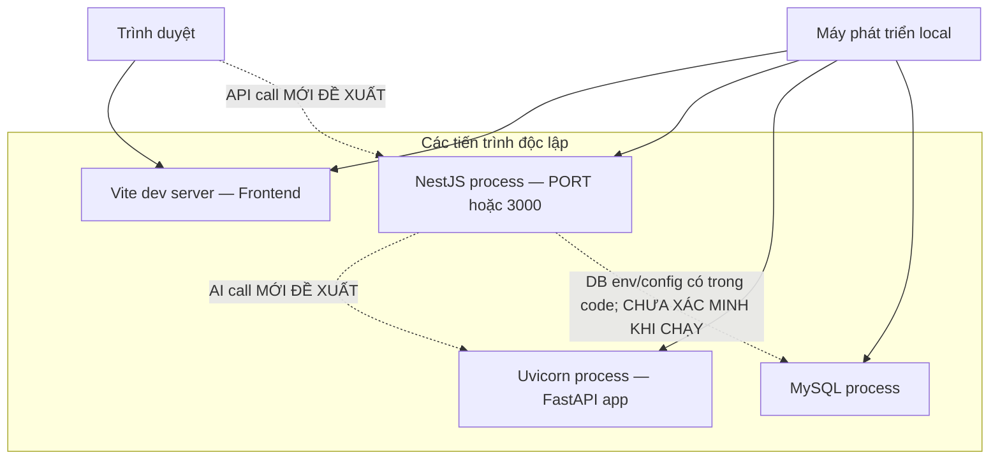

# Chapter 5 Milestone B1 — Kiến trúc hiện trạng và UML tối thiểu

## 1. Mục tiêu và phạm vi

Tài liệu này là baseline kiến trúc hiện trạng để con người rà soát cho Milestone
B1. Nội dung hợp nhất kiến trúc thành phần, cách chạy local đã biết, bằng chứng
mẫu kiến trúc và disposition các mâu thuẫn tài liệu thuộc phạm vi B1.

Tài liệu là **addendum hiện trạng** cho
[`system-architecture.md`](../../chapter-03-ai-for-requirements-product-analysis/docs/system-architecture.md),
không xóa lịch sử và không biến thiết kế mục tiêu thành chức năng đã triển khai.
Nó không mở endpoint nghiệp vụ AI, schema mới, Auth/RBAC hoặc quy tắc phân bổ.

## 2. Quy ước trạng thái

| Nhãn | Ý nghĩa |
| --- | --- |
| `ĐÃ XÁC MINH TỪ CODE` | Có symbol, cấu hình hoặc cấu trúc trực tiếp trong repository hiện tại. |
| `MỚI ĐỀ XUẤT` | Chỉ tồn tại trong tài liệu/thiết kế; code hiện tại chưa triển khai. |
| `CHƯA XÁC MINH KHI CHẠY` | Có code hoặc hướng dẫn nhưng B1 không có bằng chứng runtime tương ứng. |
| `TBD` | Cần quyết định của con người; B1 không tự chốt. |

Kết quả build/test của Phase A là bằng chứng lịch sử được ghi trong
[`architecture-baseline-audit.md`](architecture-baseline-audit.md), không được
chạy lại hoặc nâng thành bằng chứng MySQL/integration trong B1.

## 3. Baseline thành phần hiện tại

| Thành phần | Trách nhiệm hiện có | Trạng thái | Ranh giới |
| --- | --- | --- | --- |
| Frontend | React/Vite prototype, Role Preview, workspace PM/HR/DEV, luồng quyết định PM bằng mock/local state | `ĐÃ XÁC MINH TỪ CODE` | Không có HTTP client, Auth/RBAC hoặc dữ liệu production |
| Backend | NestJS health endpoint; foundation API cho Project/Sprint/Task/Employee/Skill/EmployeeSkill | `ĐÃ XÁC MINH TỪ CODE` | Chưa có risk/recommendation/simulation/decision endpoint hoặc AI client |
| Data access | TypeORM module, repository injection, 6 entity và 2 migration; `synchronize: false`, `migrationsRun: false` | `ĐÃ XÁC MINH TỪ CODE` | Kết nối MySQL và migration applied state `CHƯA XÁC MINH KHI CHẠY` |
| AI Service | FastAPI với `GET /health` | `ĐÃ XÁC MINH TỪ CODE` | Không có model, dataset, scoring, recommendation hoặc simulation |
| Frontend → Backend | Hợp đồng mục tiêu được mô tả trong tài liệu API | `MỚI ĐỀ XUẤT` | Không có lời gọi HTTP trong Frontend |
| Backend → AI Service | Hợp đồng nội bộ được mô tả trong tài liệu API | `MỚI ĐỀ XUẤT` | Không có client/gateway trong Backend |
| Role Preview | Chọn ngữ cảnh trình bày PM/HR/DEV | `ĐÃ XÁC MINH TỪ CODE` | Không phải identity, authentication hoặc authorization |

Nguồn chính: `frontend/src/App.tsx`, `frontend/src/layout/AppShell.tsx`,
`backend/src/app.module.ts`, `backend/src/database/database.config.ts` và
`ai-service/main.py`.

## 4. Sơ đồ thành phần hiện trạng

Các đường nét đứt không phải bằng chứng integration đang chạy. Sáu entity là
`Project`, `Sprint`, `Task`, `Employee`, `Skill` và `EmployeeSkill`; hai migration
nằm trong `backend/src/database/migrations/`.

## 5. Sơ đồ chạy local tối thiểu

- `frontend/package.json` có script Vite; B1 không xác nhận một port Frontend cố định.
- `backend/src/main.ts` dùng `PORT` hoặc `3000`; việc start cùng MySQL chưa được B1 chạy.
- `ai-service/main.py` cung cấp FastAPI app; host/port do lệnh Uvicorn quyết định.
- `backend/.env.example` mô tả năm biến `DB_*`; kết nối và migration vẫn
  `CHƯA XÁC MINH KHI CHẠY`.
- Không có Docker, cloud topology, service discovery hoặc gateway trong baseline này.

## 6. Bằng chứng mẫu kiến trúc

| Cấu trúc/mẫu quan sát được | Bằng chứng | Kết luận B1 | Giới hạn / trade-off |
| --- | --- | --- | --- |
| Cấu trúc modular monolith | Một `AppModule` import sáu feature module | `ĐÃ XÁC MINH TỪ CODE`; tên pattern chờ phê duyệt | Đơn giản cho MVP; module boundary chưa phải service boundary |
| Layered request path | `ProjectsController` → `ProjectsService` → `Repository<Project>` | `ĐÃ XÁC MINH TỪ CODE` cho foundation API | Chưa có application/domain layer riêng hoặc core AI flow |
| Dependency Injection | Constructor injection và `@InjectRepository` | `ĐÃ XÁC MINH TỪ CODE` | Gắn với Nest/TypeORM; không chứng minh runtime DB |
| Controller–Service separation | Controller nhận HTTP input, service chuẩn hóa/kiểm tra/truy cập dữ liệu | `ĐÃ XÁC MINH TỪ CODE` | Service hiện còn nhỏ; chưa có orchestration AI |
| Repository abstraction | TypeORM repository được inject vào service | `ĐÃ XÁC MINH TỪ CODE` | Không phải custom domain repository |
| AI adapter/gateway | Không tìm thấy trong Backend | `MỚI ĐỀ XUẤT` nếu Phase sau cần | Không được mô tả như pattern đã triển khai |

Luồng Project cung cấp bằng chứng cụ thể: `projects.controller.ts` khai báo
`@Controller('projects')`, inject `ProjectsService` và chuyển các thao tác
`create`/`findAll`/`findOne` sang service. `projects.service.ts` inject
`Repository<Project>` bằng `@InjectRepository(Project)` và gọi
`create`/`save`/`find`/`findOneBy` để truy cập dữ liệu. Bằng chứng này chỉ xác
nhận cấu trúc Controller → Service → Repository từ code; không xác nhận MySQL
đang chạy.

B1 không đề xuất thêm Strategy, Factory, Observer hoặc infrastructure pattern
chỉ để hoàn thành checklist.

## 7. Disposition mâu thuẫn thuộc B1

| Conflict | Disposition B1 | Trạng thái sau B1 |
| --- | --- | --- |
| `C5-CONFLICT-001` — kiến trúc cũ ghi Backend health-only | Baseline này ghi đúng sáu module, foundation API và TypeORM hiện có; tài liệu Chapter 3 được giữ như snapshot lịch sử | `ĐÃ XỬ LÝ TRONG ADDENDUM`, chờ review |
| `C5-CONFLICT-002` — tài liệu database cũ nói ORM/migration chưa tồn tại | Baseline phân biệt code TypeORM/6 entity/2 migration với runtime/migration applied chưa xác minh | `ĐÃ XỬ LÝ TRONG ADDENDUM`, chờ review |
| `C5-CONFLICT-004` — role context cũ không phản ánh PM/HR/DEV | Sơ đồ hiện trạng ghi ba workspace và nêu Role Preview không phải Auth/RBAC | `ĐÃ XỬ LÝ TRONG ADDENDUM`, chờ review |
| `C5-CONFLICT-007` — README gốc nói không cần env nhưng Backend bắt buộc `DB_*` | B1 ghi đúng code và `.env.example`; không sửa README gốc vì ngoài phạm vi Chapter 5 | `GIỮ MỞ / DEFERRED` cho maintainer |

`C5-CONFLICT-003` về actual foundation routes và proposed core API vẫn giữ mở
cho milestone API reconciliation; B1 không sửa hợp đồng API.

## 8. Chỉ mục bằng chứng

| Xác nhận | Đường dẫn bằng chứng | Trạng thái |
| --- | --- | --- |
| Role Preview và workspace PM/HR/DEV | `frontend/src/App.tsx`; `frontend/src/role-preview/RolePreview.tsx`; `frontend/src/layout/AppShell.tsx` | `ĐÃ XÁC MINH TỪ CODE` |
| Mock/local state của luồng PM | `frontend/src/App.tsx`; `frontend/src/project-risk/mockProjectRisks.ts`; `frontend/src/resource-recommendation/mockResourceRecommendations.ts` | `ĐÃ XÁC MINH TỪ CODE` |
| Sáu Backend module | `backend/src/app.module.ts` | `ĐÃ XÁC MINH TỪ CODE` |
| Controller–Service–Repository | `backend/src/**/*controller.ts`; `backend/src/**/*service.ts` | `ĐÃ XÁC MINH TỪ CODE` |
| Sáu entity và hai migration | `backend/src/**/*entity.ts`; `backend/src/database/migrations/` | `ĐÃ XÁC MINH TỪ CODE` |
| Cấu hình MySQL an toàn | `backend/src/database/database.config.ts`; `backend/.env.example` | Code đã xác minh; runtime chưa xác minh |
| AI health-only | `ai-service/main.py` | `ĐÃ XÁC MINH TỪ CODE` |
| Không có hai integration HTTP | Tìm kiếm Frontend HTTP call và Backend AI client trong Phase A/B1 | `ĐÃ XÁC MINH TỪ CODE` |

## 9. AI hỗ trợ và giới hạn rà soát

AI hỗ trợ tổng hợp evidence index, đối chiếu source với audit Phase A, tạo hai
sơ đồ Mermaid và chuẩn hóa trạng thái conflict. AI không chạy ứng dụng, database,
migration, build hoặc test trong B1 và không phê duyệt pattern/kiến trúc thay con người.

## 10. Điểm cần human review

Reviewer chọn `Approved`, `Changes requested` hoặc `Keep as proposed` cho từng mục:

| Review ID | Nội dung cần xác nhận | Trạng thái review |
| --- | --- | --- |
| `B1-DEC-01` | Dùng tài liệu này làm addendum hiện trạng thay cho việc sửa snapshot Chapter 3 | Chờ review |
| `B1-DEC-02` | Chấp nhận tên “modular monolith” và “layered architecture” hay chỉ giữ “source-evidenced structure” | Chờ review |
| `B1-DEC-03` | Xác nhận không có runtime evidence mới cho MySQL, migration và inter-service calls | Chờ review |
| `B1-DEC-04` | Giữ Chapter 3/README gốc nguyên trạng và defer các conflict ngoài phạm vi | Chờ review |
| `B1-VIEW-01` | Sơ đồ thành phần phản ánh đúng implemented/proposed/not-verified | Chờ review |
| `B1-VIEW-02` | Sơ đồ local không tạo cam kết Docker/cloud/runtime chưa có | Chờ review |

Milestone B1 hiện ở trạng thái **chờ human review**. Chapter 5 vẫn đang thực
hiện; không tự động chuyển sang sequence/API reconciliation hoặc data-model
milestone trước khi các mục trên được xử lý.
